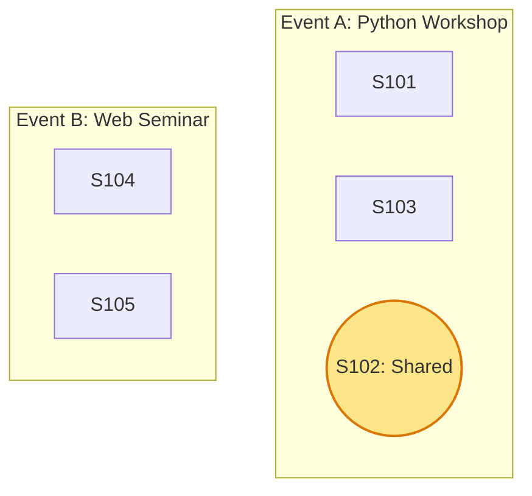
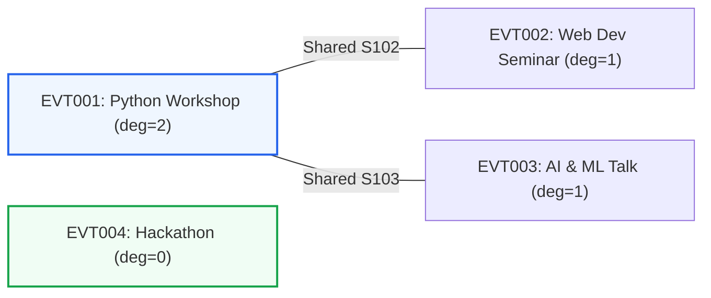

# Mathematical Foundations of the Smart College Event Planning Assistant
**Course:** Mathematical Foundations of Computer Science (MFCS)  
**Project:** Smart College Event Planning Assistant  
**Language & Engine:** Pure Python 3 (Standard Library Only — Rule-Based, Deterministic, Explainable)  
**Primary MFCS Concept:** Graph Theory — Graph Coloring & Vertex Degree Heuristics  
**Supporting MFCS Concept:** Set Theory — Sets, Cardinality, and Set Intersection  
**Additional Mathematical Frameworks:** Allen's Interval Algebra, Metric Distance & Separation Inequalities, Order Theory & Lexicographical Sorting, Constraint Satisfaction Formulation (CSP)

---

## 1. Executive Summary & Mathematical Taxonomy

Scheduling independent events subject to shared human resources (students/attendees) and physical resources (venues) is fundamentally an **NP-complete discrete optimization problem** reducible to **Graph Vertex Coloring** and **Interval Scheduling**. 

Rather than relying on opaque machine-learning models, this project utilizes pure, explainable mathematical foundations from discrete mathematics.

### Mathematical Taxonomy Matrix

| Mathematical Domain | Abstract Concept | System Counterpart | Code Implementation | Primary File & Lines | Purpose / Why Used |
| :--- | :--- | :--- | :--- | :--- | :--- |
| **Set Theory** | Finite Set $P(A) \subset U$ | Registered participants of event $A$ | Python `set` of strings | `web/planner.py` (L320–331) | Ensures $O(1)$ uniqueness and fast membership queries. |
| **Set Theory** | Set Intersection $P(A) \cap P(B)$ | Common students between two events | `first_set.intersection(second_set)` | `web/planner.py` (L357–361) | Determines whether two events compete for identical student resources. |
| **Set Theory** | Cardinality $\|P(A)\|$ | Participant headcount | `len(event["participants"])` | `web/planner.py` (L392) | Acts as secondary tie-breaker in difficulty ordering. |
| **Graph Theory** | Undirected Simple Graph $G = (V, E)$ | Event Conflict Graph | `dict[str, set[str]]` (Adjacency List) | `web/planner.py` (L363–376) | Formal topological model abstracting event constraints into vertices and edges. |
| **Graph Theory** | Vertex $v \in V$ | An individual event | Event dictionary keyed by `event_id` | `web/planner.py` (L365) | Represents atomic discrete tasks requiring temporal allocation. |
| **Graph Theory** | Edge $\{u, v\} \in E$ | Pairwise mutual exclusion (Conflict) | Bidirectional link in adjacency sets | `web/planner.py` (L373–374) | Models the constraint: events $u$ and $v$ cannot share the same time slot. |
| **Graph Theory** | Vertex Degree $\deg(v)$ | Number of conflicting neighbor events | `len(graph[event_id])` | `web/planner.py` (L391) | Quantifies **scheduling difficulty** (fewer safe choices remaining). |
| **Graph Theory** | Proper Vertex Coloring $c: V \to C$ | Timetable assignment | Map $c(v) \mapsto (\text{start}, \text{end})$ | `web/planner.py` (L602–674) | Ensures adjacent vertices receive distinct colors (non-overlapping slots). |
| **Interval Algebra** | Linear Projection $f(t) \in \mathbb{N}_0$ | Time converted to minutes after midnight | $f(HH:MM) = 60 \cdot HH + MM$ | `web/planner.py` (L904–909) | Maps 24h clock strings to an ordered, discrete numeric space $(\mathbb{N}_0, \le)$. |
| **Interval Algebra** | Interval Overlap $I_1 \cap I_2 \neq \emptyset$ | Temporal clash predicate | $s_1 < e_2 \land s_2 < e_1$ | `web/planner.py` (L868–872) | Detects whether two scheduled durations overlap in continuous/discrete time. |
| **Metric Spaces** | Metric Distance $d(I_1, I_2)$ | Separation gap between venue uses | $\max(s_2 - e_1, s_1 - e_2)$ | `web/planner.py` (L853–866) | Enforces 25–30 min physical turnaround/buffer between sessions in the same hall. |
| **Order Theory** | Lexicographical Product $\le_{\text{lex}}$ | Deterministic priority ranking | Sort key $(-\deg(v), -\|P(v)\|, \text{ID})$ | `web/planner.py` (L410–416) | Total preorder guaranteeing stable, explainable, reproducible scheduling order. |

---

## 2. Set Theory: Participant Constraints & Shared Resource Discovery

### 2.1 Formal Mathematical Formulation

Let $U$ be the universe of discourse consisting of all registered college students:
$$U = \{s_1, s_2, s_3, \dots, s_m\}$$

For any event $A$, its participant roster is modeled as a finite subset of $U$:
$$P(A) \subseteq U, \quad P(A) = \{s \in U \mid \text{student } s \text{ is registered for event } A\}$$

#### Set Operations Applied:

1. **Cardinality:**
   $$\|P(A)\| = n \in \mathbb{N}_0$$
   Represents the total attendance of the event.

2. **Set Intersection:**
   $$P(A) \cap P(B) = \{s \in U \mid s \in P(A) \land s \in P(B)\}$$
   Identifies the specific subset of students registered for both events simultaneously.

3. **Disjointness:**
   $$P(A) \cap P(B) = \emptyset$$
   When two events share no participants, they are mutually independent regarding student attendance.

4. **Participant Conflict Predicate:**
   $$\text{HasSharedStudents}(A, B) \iff (P(A) \cap P(B) \neq \emptyset) \land (\text{Date}(A) = \text{Date}(B))$$



### 2.2 Where and How in Code

In `web/planner.py`:

```python
def make_participant_list(self, value):
    """Convert input into a sorted list of unique uppercase participant IDs."""
    participant_ids = set()
    for item in str(value or "").split(","):
        item = item.strip().upper()
        if item:
            participant_ids.add(item)
    return sorted(participant_ids)

def get_shared_participants(self, first, second):
    """Find participant IDs that appear in both events using set intersection."""
    first_participants = set(first.get("participants", []))
    second_participants = set(second.get("participants", []))
    return first_participants.intersection(second_participants)
```

### 2.3 Why Set Theory Was Chosen

1. **Axiomatic Match:** A student cannot be counted twice in a single event. Sets enforce the mathematical property that elements are unique ($\{s_1, s_1\} = \{s_1\}$).
2. **Computational Complexity:** Testing list membership for $n$ participants across $m$ events with lists requires $O(\|P(A)\| \times \|P(B)\|)$ operations. Using hash sets, Python calculates set intersection in average-case time:
   $$O(\min(\|P(A)\|, \|P(B)\|))$$
   with $O(1)$ average hash-table lookups.
3. **Semantic Distinction:** Set intersection alone indicates a *potential conflict edge*, not yet a *schedule clash*. A clash only manifests if both events are allocated overlapping intervals in time.

---

## 3. Graph Theory: Conflict Modeling & Greedy Graph Coloring

### 3.1 Graph Representation

The scheduling constraints of the institution are modeled as an undirected, unweighted simple graph $G = (V, E)$:

- **Vertex Set $V$:** Each event $e_i$ is a vertex in $V$:
  $$V = \{v_1, v_2, \dots, v_n\}$$
- **Edge Set $E$:** An undirected edge $\{u, v\} \in E$ exists between two distinct events if and only if they occur on the same date and have a non-empty participant intersection:
  $$E = \Big\{\{u, v\} \subseteq V \;\Big|\; u \neq v \;\land\; \text{Date}(u) = \text{Date}(v) \;\land\; P(u) \cap P(v) \neq \emptyset \Big\}$$



#### Data Structure Choice: Adjacency List
The graph is represented in memory as an adjacency list using Python dictionaries and sets:
$$\text{graph}: V \to \mathcal{P}(V)$$
```python
graph = {
    "EVT001": {"EVT002", "EVT003"},
    "EVT002": {"EVT001"},
    "EVT003": {"EVT001"},
    "EVT004": set()
}
```
**Advantage:** Sparse graphs ($|E| \ll |V|^2$) require $O(|V| + |E|)$ space, compared to an Adjacency Matrix which consumes $O(|V|^2)$ space regardless of edge density.

### 3.2 Vertex Degree & Scheduling Difficulty Metric

In graph theory, the degree of a vertex $v$, denoted $\deg(v)$, is the number of edges incident to $v$:
$$\deg(v) = \Big|\{u \in V \mid \{u, v\} \in E\}\Big| = \big|\text{Adj}(v)\big|$$

#### The Handshaking Lemma (Euler)
The sum of degrees across all vertices equals twice the total number of edges:
$$\sum_{v \in V} \deg(v) = 2|E|$$
This invariant is tested in our validation suites to verify graph symmetry.

#### Academic Distinction: Scheduling Difficulty vs. Importance
> [!IMPORTANT]
> In this system, **conflict degree $\deg(v)$ is strictly a measure of scheduling constraint/difficulty, NOT institutional importance or academic priority.**
> 
> A vertex with $\deg(v) = 3$ is connected to 3 other events that cannot share its time slot. Therefore, its domain of available colors is reduced more rapidly than an isolated vertex ($\deg = 0$).

### 3.3 The Graph Coloring Problem

Let $C = \{c_1, c_2, \dots, c_k\}$ denote a set of $k$ distinct colors. In our system, each color $c_i$ represents an allowable discrete 1-hour time slot:
$$C = \{\text{09:00-10:00}, \text{10:00-11:00}, \dots, \text{17:00-18:00}\}$$

A **proper vertex coloring** of $G$ is a mapping:
$$c: V \to C$$
such that:
$$\forall \{u, v\} \in E, \quad c(u) \neq c(v)$$

#### Chromatic Number $\chi(G)$
The chromatic number $\chi(G)$ is the minimal number of colors needed to color $G$:
$$\chi(G) = \min \big\{ k \in \mathbb{N} \mid G \text{ is } k\text{-colorable} \big\}$$

Finding $\chi(G)$ for general graphs is an **NP-complete problem** (Karp, 1972). Testing whether a graph can be colored with 3 colors ($k \ge 3$) is NP-hard.

### 3.4 The Greedy Graph Coloring Algorithm (Welsh-Powell Heuristic)

To solve this in polynomial time for real-world interactive scheduling, we employ a **Greedy Coloring Algorithm** augmented with degree ordering (inspired by the Welsh-Powell Algorithm):

#### Algorithm Steps:
1. **Build Conflict Graph:** Construct $G = (V, E)$ via set intersection across all event pairs.
2. **Order Vertices:** Sort all unassigned vertices in descending order of vertex degree:
   $$v_1, v_2, \dots, v_n \quad \text{such that} \quad \deg(v_1) \ge \deg(v_2) \ge \dots \ge \deg(v_n)$$
   *(Ties broken by participant count $\|P(v)\|$, then alphabetical event ID).*
3. **Sequential Color Assignment:**
   For each vertex $v_i$ in the ordered sequence:
   - Identify colors already assigned to its neighbors:
     $$C_{\text{forbidden}}(v_i) = \{ c(u) \mid u \in \text{Adj}(v_i) \land u \text{ is already colored} \}$$
   - Search the candidate color palette $C = (c_1, c_2, \dots, c_k)$ in fixed order.
   - Assign the first color $c_j \in C$ such that:
     1. $c_j \notin C_{\text{forbidden}}(v_i)$ (No participant clash)
     2. $c_j$ satisfies venue physical availability and post-session buffer
     3. $c_j$ falls within the event's preferred time window $[w_{\text{start}}, w_{\text{end}}]$
   - If no valid color exists in $C$, mark $v_i$ as **Unassigned** and record the exact mathematical blocking reason.

#### Code Implementation (`web/planner.py` lines 628–665):
```python
# Sort unassigned events by priority ranking (degree desc, participant count desc, event_id asc)
ranked = self.get_priority_ranking()
ranked_ids = [item["event_id"] for item in ranked]

for event_id in ranked_ids:
    if event_id in scheduled:
        continue

    event = self.events[event_id]
    assigned_slot = None
    slot_block_reasons = []

    for slot in self.TIME_SLOTS:
        available, reason = self.slot_is_available(event_id, slot, graph, scheduled)
        if available:
            assigned_slot = slot
            break
        else:
            slot_block_reasons.append(f"{slot[0]}-{slot[1]}: {reason}")

    if assigned_slot:
        scheduled[event_id] = assigned_slot
        event["start_time"], event["end_time"] = assigned_slot
        event["status"] = "Scheduled"
    else:
        unassigned_explanations[event_id] = {
            "event_name": event["event_name"],
            "reason": "All candidate slots violated participant, venue, or buffer constraints.",
            "details": slot_block_reasons[:3],
        }
```

### 3.5 Honest Algorithmic Limitations

> [!NOTE]
> Greedy coloring is guaranteed to produce a **valid** coloring (no adjacent vertices share a color), but it is **not guaranteed to find the absolute minimum chromatic number $\chi(G)$** for all graph topologies.
> 
> The number of colors used by greedy coloring is bounded from above by:
> $$\chi(G) \le \Delta(G) + 1$$
> where $\Delta(G) = \max_{v \in V} \deg(v)$ is the maximum vertex degree of the graph (Brooks' Theorem guarantees $\chi(G) \le \Delta(G)$ for non-complete, non-odd-cycle graphs).
> 
> In all project outputs, documentation, and user interfaces, the timetable is accurately termed a **"valid greedy schedule"**, not an "optimal schedule".

---

## 4. Interval Algebra: Temporal Modeling & Clash Predicates

### 4.1 Discrete Linear Time Mapping

Time representation is converted from sexagesimal string format `HH:MM` to a 1-dimensional discrete integer coordinate line $(\mathbb{N}_0, \le)$ representing elapsed minutes from midnight:

$$\tau: \text{String} \to [0, 1439] \subset \mathbb{N}_0$$
$$\tau(\text{"HH:MM"}) = 60 \times \text{int}(HH) + \text{int}(MM)$$

Example:
$$\tau(\text{"09:30"}) = 60 \times 9 + 30 = 570$$
$$\tau(\text{"11:00"}) = 60 \times 11 + 0 = 660$$

### 4.2 Interval Definition

An event $e$'s scheduled duration is a half-open temporal interval on the real line:
$$I(e) = \big[ s(e), \; e(e) \big) = \big\{ t \in \mathbb{R} \;\big|\; s(e) \le t < e(e) \big\}$$
where $s(e) = \tau(\text{start\_time})$ and $e(e) = \tau(\text{end\_time})$, with the strict constraint $s(e) < e(e)$.

### 4.3 Allen's Interval Overlap Condition

Two temporal intervals $I_1 = [s_1, e_1)$ and $I_2 = [s_2, e_2)$ have a non-empty intersection ($I_1 \cap I_2 \neq \emptyset$) if and only if:
$$\text{Overlap}(I_1, I_2) \iff s_1 < e_2 \quad \land \quad s_2 < e_1$$

#### Mathematical Proof via De Morgan's Laws:
Two intervals are disjoint ($I_1 \cap I_2 = \emptyset$) if and only if $I_1$ finishes before $I_2$ starts, or $I_2$ finishes before $I_1$ starts:
$$\text{Disjoint}(I_1, I_2) \iff e_1 \le s_2 \quad \lor \quad e_2 \le s_1$$
Negating the disjointness condition using De Morgan's Law gives the overlap predicate:
$$\text{Overlap}(I_1, I_2) = \neg \text{Disjoint}(I_1, I_2) = \neg (e_1 \le s_2 \lor e_2 \le s_1) \iff (s_1 < e_2 \land s_2 < e_1)$$

#### Code Implementation (`web/planner.py` lines 868–872):
```python
def slots_overlap(self, first_slot, second_slot):
    """Return True when two event time ranges overlap."""
    first_start, first_end = self.slot_as_minutes(first_slot)
    second_start, second_end = self.slot_as_minutes(second_slot)
    return first_start < second_end and second_start < first_end
```

### 4.4 The Compound Simultaneous Participant Clash Formula

A true scheduling clash between event $A$ and event $B$ occurs under the logical conjunction ($\land$) of three conditions across calendar, set theory, and interval algebra:

$$\text{SimultaneousClash}(A, B) \iff \Big( \text{Date}(A) = \text{Date}(B) \Big) \;\land\; \Big( P(A) \cap P(B) \neq \emptyset \Big) \;\land\; \Big( I(A) \cap I(B) \neq \emptyset \Big)$$

This distinction separates a **potential conflict** (shared students, represented by a graph edge) from a **realized collision** (shared students booked at the exact same moment).

---

## 5. Metric Spaces & Venue Buffer Inequalities

### 5.1 Interval Metric Separation

Venues cannot host two events simultaneously. Furthermore, physical venues require turnaround time for equipment cleanup, student egress, and seating reset.

For two disjoint intervals $I_1 = [s_1, e_1)$ and $I_2 = [s_2, e_2)$ with $e_1 \le s_2$, the metric separation distance between them is:
$$d(I_1, I_2) = s_2 - e_1$$

For arbitrary non-overlapping intervals, the temporal distance function is:
$$d(I_1, I_2) = \max(s_2 - e_1, \; s_1 - e_2)$$

### 5.2 Venue Constraint Formulation

Let $\delta_{\text{buffer}} \in \{25, 30\}$ minutes be the configurable post-session buffer.

For any pair of events $A$ and $B$ sharing the same physical venue on the same date:
$$\text{Venue}(A) = \text{Venue}(B) \;\land\; \text{Date}(A) = \text{Date}(B) \implies \begin{cases}
I(A) \cap I(B) = \emptyset & \text{(Zero Overlap — Hard Constraint)} \\
d(I(A), I(B)) \ge \delta_{\text{buffer}} & \text{(Buffer Spacing — Metric Constraint)}
\end{cases}$$

#### Buffer Violation vs. Hard Venue Overlap:
- **Hard Venue Overlap:** $s(A) < e(B) \land s(B) < e(A)$. (Two events booked in the same hall at the same time).
- **Buffer Violation:** $I(A) \cap I(B) = \emptyset$, but $0 \le d(I(A), I(B)) < \delta_{\text{buffer}}$.

#### Code Implementation (`web/planner.py` lines 853–866):
```python
def slots_are_too_close(self, first_slot, second_slot):
    """Return True when two non-overlapping slots are closer than venue_buffer."""
    first_start, first_end = self.slot_as_minutes(first_slot)
    second_start, second_end = self.slot_as_minutes(second_slot)

    # Overlapping slots are a hard overlap, not a buffer issue
    if first_start < second_end and second_start < first_end:
        return False

    gap = max(second_start - first_end, first_start - second_end)
    return gap < self.venue_buffer
```

---

## 6. Order Theory: Lexicographical Ordering & Determinism

### 6.1 Total Preorder and Strict Weak Ordering

When sorting vertices for the greedy coloring algorithm, arbitrary sorting leads to nondeterministic timetables. To enforce **reproducibility and mathematical transparency**, events are ordered using a composite projection function:

$$\Phi: V \to \mathbb{Z} \times \mathbb{Z} \times \Sigma^*$$
$$\Phi(v) = \Big( -\deg(v), \; -\|P(v)\|, \; \text{ID}(v) \Big)$$

We define a strict weak ordering $<_{\text{lex}}$ over the Cartesian product:
1. **Primary Criterion:** $-\deg(v)$ (Higher conflict degree ordered first).
2. **Secondary Criterion:** $-\|P(v)\|$ (Higher participant count ordered first).
3. **Tertiary Criterion:** $\text{ID}(v)$ (Alphabetical ASCII order: `"EVT001" < "EVT002"`).

Because $\text{ID}(v)$ is unique for every event, this forms a **Strict Total Order**:
$$\forall u, v \in V \quad (u \neq v) \implies (u <_{\text{lex}} v) \lor (v <_{\text{lex}} u)$$
This guarantees that running "Create Schedule" repeatedly always produces the identical, deterministic timetable.

#### Code Implementation (`web/planner.py` lines 410–416):
```python
ranking.sort(
    key=lambda item: (
        -item["conflict_degree"],
        -item["participant_count"],
        item["event_id"],
    )
)
```

---

## 7. Constraint Satisfaction Problem (CSP) Formulation

The entire application can be formally modeled as a discrete **Constraint Satisfaction Problem (CSP)** defined by the triplet $(X, D, C)$:

### 7.1 Variables ($X$)
$$X = \{x_1, x_2, \dots, x_n\}$$
Each variable $x_i$ represents an event requiring a time slot assignment.

### 7.2 Domains ($D$)
For each variable $x_i$, its domain $D_i$ is the subset of candidate time slots that lie entirely within its preferred time window $W(x_i) = [w_{\text{start}}, w_{\text{end}}]$:
$$D_i = \Big\{ \text{slot} \in \text{TIME\_SLOTS} \;\Big|\; s(\text{slot}) \ge w_{\text{start}}(x_i) \;\land\; e(\text{slot}) \le w_{\text{end}}(x_i) \Big\}$$

### 7.3 Constraints ($C$)
1. **Participant Non-Collision (Graph Coloring Constraint):**
   $$\forall \{x_i, x_j\} \in E, \quad x_i \neq x_j$$
2. **Venue Mutual Exclusion (Spatial Disjointness Constraint):**
   $$\forall x_i, x_j \text{ with } \text{Venue}(x_i) = \text{Venue}(x_j) \land \text{Date}(x_i) = \text{Date}(x_j): \quad I(x_i) \cap I(x_j) = \emptyset$$
3. **Venue Turnaround Separation (Metric Buffer Constraint):**
   $$\forall x_i, x_j \text{ with } \text{Venue}(x_i) = \text{Venue}(x_j) \land \text{Date}(x_i) = \text{Date}(x_j): \quad d(I(x_i), I(x_j)) \ge \delta_{\text{buffer}}$$

---

## 8. Computational Complexity Analysis

Let:
- $N = |V|$ be the number of events.
- $M = \max |P(e)|$ be the maximum number of participants registered in any event.
- $K = |C|$ be the number of discrete time slots (constant $K = 9$ in this implementation).
- $E = |E|$ be the number of conflict edges ($0 \le E \le \frac{N(N-1)}{2}$).

| Algorithm / Feature | Primary Function | Time Complexity | Space Complexity | Mathematical Justification |
| :--- | :--- | :--- | :--- | :--- |
| **Participant Comparison** | `get_shared_participants()` | $O(M)$ | $O(M)$ | Hash set construction and intersection of size up to $M$. |
| **Pairwise Event Traversal** | `get_event_pairs()` | $O(N^2)$ | $O(N^2)$ | Generates $\binom{N}{2} = \frac{N(N-1)}{2}$ unordered pairs. |
| **Conflict Graph Construction** | `build_conflict_graph()` | $O(N^2 \cdot M)$ | $O(N + E)$ | $\binom{N}{2}$ pairs evaluated, each taking $O(M)$ for set intersection. |
| **Priority Ranking** | `get_priority_ranking()` | $O(N \log N + N^2 \cdot M)$ | $O(N + E)$ | Graph construction followed by Timsort over $N$ items. |
| **Candidate Slot Availability** | `slot_is_available()` | $O(\deg(v) + N)$ | $O(1)$ | Checks adjacent vertices in $G$ and scheduled events in venue. |
| **Greedy Graph Coloring** | `create_schedule()` | $O(N \cdot K \cdot (\Delta(G) + N))$ | $O(N)$ | Evaluates at most $K$ slots for $N$ vertices against their neighbors. |
| **Schedule Validation** | `validate_schedule()` | $O(N^2)$ | $O(N^2)$ | Validates all $\binom{N}{2}$ pairs for interval overlap and buffer. |

---

## 9. MFCS Viva & Oral Examination Questions & Answers

### Q1: Why is Graph Coloring the primary mathematical model for this project?
**Answer:** In scheduling, time slots represent discrete resources that cannot be shared by mutually exclusive activities. In graph theory, the Graph Vertex Coloring problem assigns colors to vertices such that no two adjacent vertices share the same color. By mapping events to vertices, participant conflicts to edges, and time slots to colors, the scheduling problem maps directly to finding a valid vertex coloring of the conflict graph.

### Q2: How does Set Intersection relate to Graph Coloring in your code?
**Answer:** Set Theory provides the criteria for generating the graph's edge set $E$. For any two events $A$ and $B$, we take the set intersection of their participant rosters $P(A) \cap P(B)$. If the intersection is non-empty and the events are on the same date, an undirected edge $\{A, B\}$ is added to the graph. Thus, set intersection acts as the predicate that establishes edges in our conflict graph.

### Q3: What does the degree of a vertex represent, and is it a measure of event importance?
**Answer:** The degree $\deg(v)$ is the number of edges incident to vertex $v$, which corresponds to the number of other events sharing participants with $v$. It measures **scheduling difficulty / constraint level**, because a vertex with a high degree has more neighbors and consequently fewer available color choices. It is **not** a measure of institutional importance or academic priority.

### Q4: Why is greedy graph coloring not claimed to be "optimal"?
**Answer:** Finding the minimum number of colors $\chi(G)$ (the chromatic number) is an NP-complete problem. A greedy coloring algorithm assigns the first available color based on a heuristic order. While it guarantees a **valid** schedule (no conflicts), it can use more colors than the theoretical minimum $\chi(G)$ depending on the graph topology. Therefore, we honestly describe our output as a "valid greedy timetable", not a mathematically optimal one.

### Q5: How do you mathematically detect if two time intervals overlap?
**Answer:** Given two half-open intervals $I_1 = [s_1, e_1)$ and $I_2 = [s_2, e_2)$ converted to minutes after midnight, they overlap if and only if:
$$s_1 < e_2 \quad \land \quad s_2 < e_1$$
This is derived by applying De Morgan's laws to the negation of the condition that one interval strictly precedes the other.

### Q6: What is the mathematical difference between a Potential Conflict and a Simultaneous Clash?
**Answer:**
- A **Potential Conflict** is a graph edge $\{A, B\} \in E$, meaning $P(A) \cap P(B) \neq \emptyset$. The events share students, but may be safely scheduled at different hours.
- A **Simultaneous Clash** is a compound condition: $\{A, B\} \in E \land I(A) \cap I(B) \neq \emptyset$. The events share students and overlap in time, creating a physical impossibility for attendees.

### Q7: How is the venue buffer modeled mathematically?
**Answer:** If two events $A$ and $B$ share the same venue, we compute the metric distance between their intervals: $d(I(A), I(B)) = \max(s(B) - e(A), s(A) - e(B))$. The venue buffer rule enforces that $d(I(A), I(B)) \ge \delta_{\text{buffer}}$, where $\delta \in \{25, 30\}$ minutes, preventing back-to-back bookings without setup time.

### Q8: Why did you use an Adjacency List instead of an Adjacency Matrix?
**Answer:** An Adjacency List requires $O(|V| + |E|)$ space, whereas an Adjacency Matrix requires $O(|V|^2)$. College event conflict graphs are typically sparse because most events do not share students. The adjacency list saves memory and allows neighbor traversal in $O(\deg(v))$ time rather than scanning $|V|$ entries.

### Q9: How do you break ties when sorting vertices by degree?
**Answer:** We define a strict total preorder using a 3-tuple lexicographical key: $(-\deg(v), -|P(v)|, \text{ID}(v))$. If two vertices have identical degrees, the tie is broken by larger participant count, and then alphabetically by unique Event ID. This ensures the greedy coloring process is 100% deterministic and reproducible.

### Q10: Can this system be formulated as a Constraint Satisfaction Problem (CSP)?
**Answer:** Yes. The variables $X$ are events; the domain $D_i$ of each variable is the set of time slots fitting its preferred window; and the constraints $C$ are the graph coloring condition ($c(u) \neq c(v)$ for all $\{u, v\} \in E$), the venue mutual exclusion condition ($I(A) \cap I(B) = \emptyset$), and the metric buffer separation ($d(I(A), I(B)) \ge \delta$).
